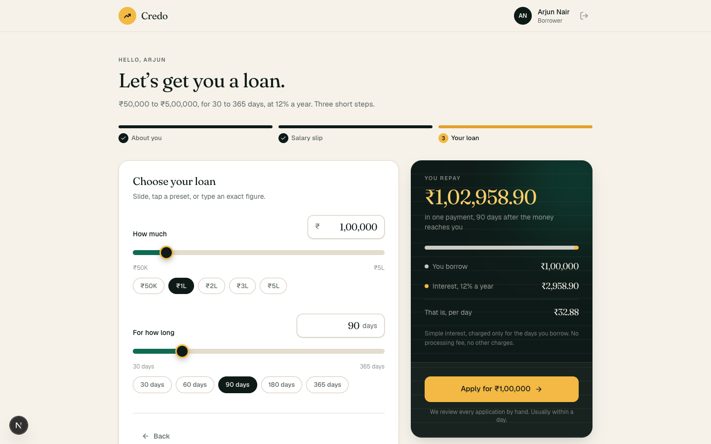
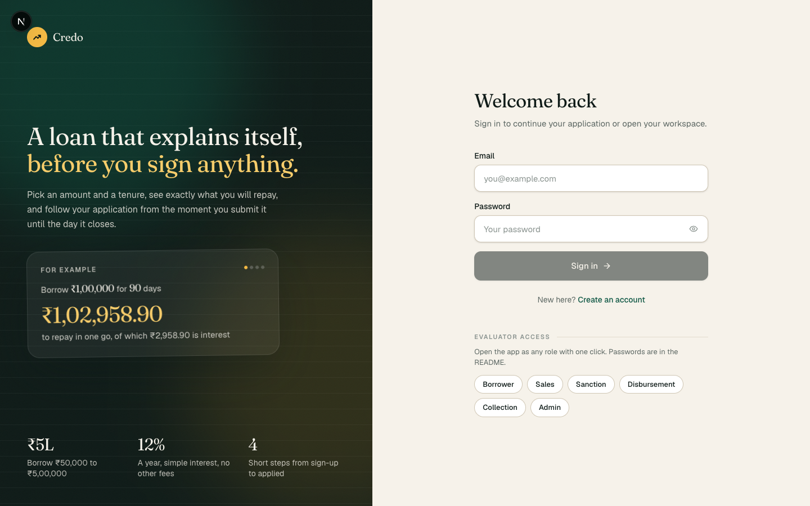
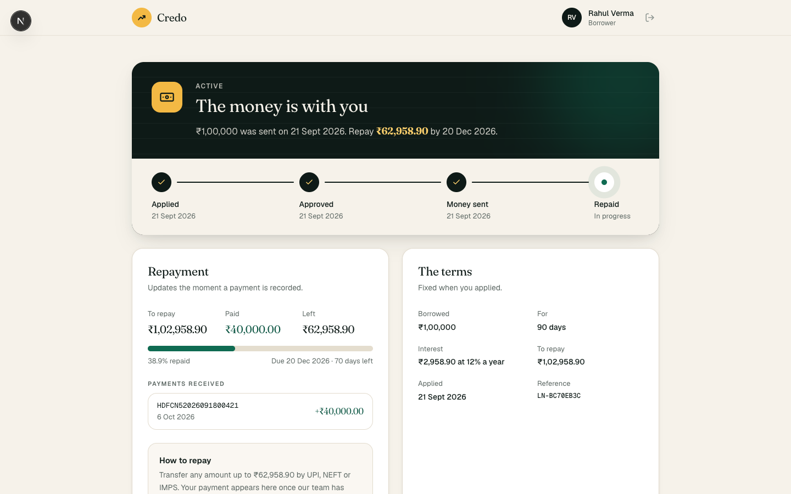
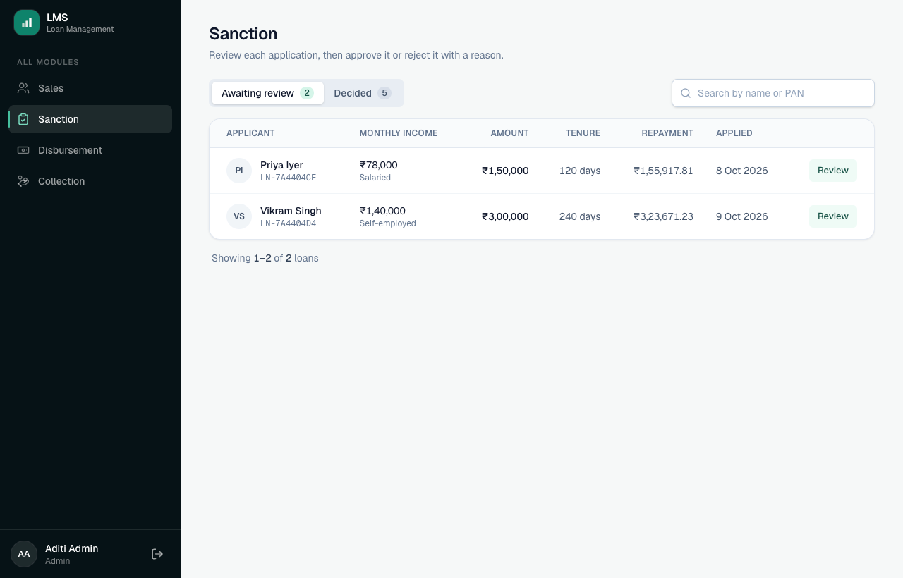
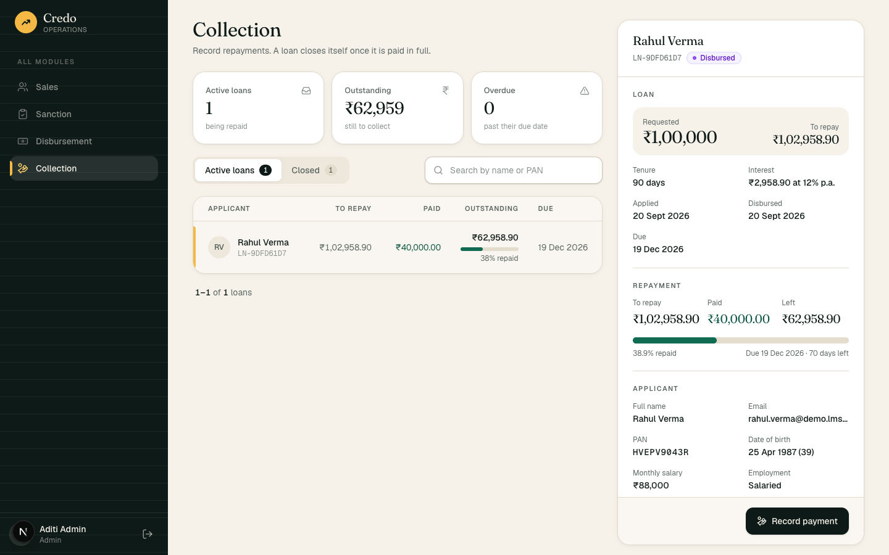
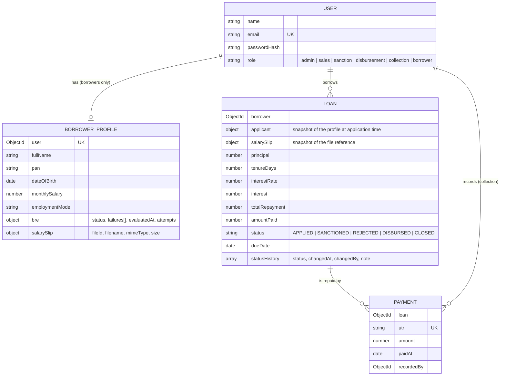
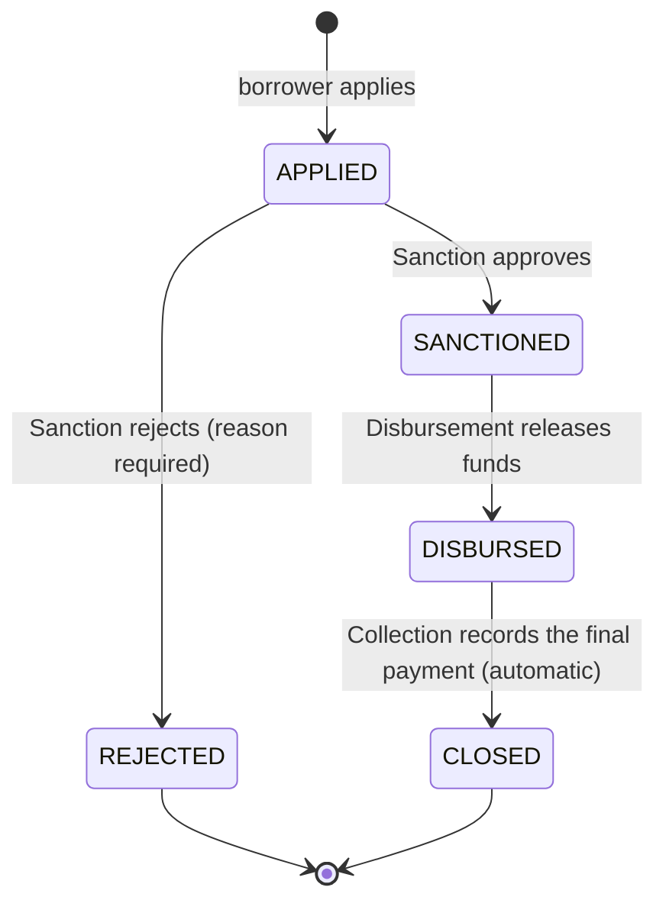

# Credo · Loan Management System

A lending platform with two sides, designed as two products. **Borrowers** get a consumer app: sign up, give a few details, upload a salary slip and choose a loan, with the repayment figure rolling as the sliders move. **Internal executives** get an operations workbench where each role sees only its own module and moves loans through sanction, disbursement and collection with the record open beside the queue.

| | |
|---|---|
| **Live app** | _add the deployed frontend URL here_ |
| **API** | _add the deployed API URL here_ |
| **Walkthrough video** | _add the video link here_ |

**Stack:** Next.js 16 (App Router) · TypeScript · Tailwind CSS · Node.js · Express 5 · MongoDB · Mongoose · JWT · bcrypt



| Sign in | Tracking an active loan |
|---|---|
|  |  |

| Sanction: queue and the open application side by side | Collection: an active loan with its ledger |
|---|---|
|  |  |

## Contents

- [Login credentials](#login-credentials)
- [What it does](#what-it-does)
- [Run it locally](#run-it-locally)
- [Project structure](#project-structure)
- [Data model](#data-model)
- [Loan lifecycle](#loan-lifecycle)
- [Access control](#access-control)
- [API reference](#api-reference)
- [Design decisions](#design-decisions)
- [Tests](#tests)
- [Deployment](#deployment)
- [Limitations and next steps](#limitations-and-next-steps)

## Login credentials

The seed script creates one account per role. On the login page these are also offered under **Evaluator access**: one click signs you in as that role.

| Role | Email | Password | Sees |
|---|---|---|---|
| Admin | `admin@lms.dev` | `Admin@123` | All four dashboard modules |
| Sales | `sales@lms.dev` | `Sales@123` | Sales |
| Sanction | `sanction@lms.dev` | `Sanction@123` | Sanction |
| Disbursement | `disbursement@lms.dev` | `Disburse@123` | Disbursement |
| Collection | `collection@lms.dev` | `Collect@123` | Collection |
| Borrower | `borrower@lms.dev` | `Borrower@123` | Borrower portal |

`npm run seed:demo` additionally creates ten sample borrowers so every module has data on first login: leads at each stage for Sales, and at least one loan in every status. They sign in with their email (for example `rahul.verma@demo.lms.dev`) and the password `Demo@1234`. New borrowers can also simply sign up.

## What it does

### Borrower portal

1. **Sign up / log in.** Passwords are hashed with bcrypt. Every page except login and sign-up needs a session.
2. **Personal details and eligibility.** Name, PAN, date of birth, monthly salary and employment mode. A Business Rule Engine (BRE) on the server decides eligibility:

   | Rule | Rejected when |
   |---|---|
   | Age | not between 23 and 50 |
   | Salary | below ₹25,000 a month |
   | PAN | not in valid PAN format |
   | Employment | unemployed |

   All failed rules are reported together, and the borrower can correct a mistake and try again. The rules are not shown to the borrower beforehand; the browser only checks that the fields are filled in and well-formed (see [Design decisions](#design-decisions)).
3. **Salary slip.** PDF, JPG or PNG up to 5 MB, stored in MongoDB (GridFS) and linked to the application.
4. **Loan configuration.** Sliders for amount (₹50,000 to ₹5,00,000) and tenure (30 to 365 days), with an offer card whose figures roll to the new values as they move. Interest is 12% a year, simple interest:

   ```
   SI = (P × R × T) / (365 × 100)        T = tenure in days
   Total repayment = P + SI

   ₹1,00,000 for 90 days  →  SI = ₹2,958.90, total ₹1,02,958.90
   ```

   Applying creates the loan with status `APPLIED`. From then on the borrower sees a tracker in plain words (applied, approved, money sent, repaid), the terms, and repayments as they are recorded.

### Operations dashboard

| Module | Works on | Actions |
|---|---|---|
| **Sales** | Borrowers who registered but have not applied | Lead list with stage (registered, not eligible, slip pending, ready to apply), funnel counts, search, the reasons a lead was turned down |
| **Sanction** | `APPLIED` loans | Review the applicant and the salary slip, then **approve** or **reject with a reason** |
| **Disbursement** | `SANCTIONED` loans | **Mark as disbursed**, which sets the due date from the tenure |
| **Collection** | `DISBURSED` loans | **Record a payment** (unique UTR, amount, date). The loan **closes automatically** when it is paid in full |

Each loan module opens with three key figures (count, amount, and the oldest wait or overdue count), then a queue (work waiting for that team) and a history (what it has already handled). From 1280px up the open record sits beside the queue, so a reviewer moves from one application to the next without a modal in the way; on smaller screens the same record slides in as a drawer, and tables collapse into cards on a phone.

## Run it locally

**You need:** Node.js 20 or newer, and MongoDB 6 or newer. The repository includes a Docker Compose file for MongoDB; a MongoDB Atlas connection string works just as well.

```bash
# 1. Install dependencies for the root, the API and the web app
npm run setup

# 2. Start MongoDB (skip if you use Atlas or your own MongoDB)
docker compose up -d

# 3. Configure the environment
cp server/.env.example server/.env        # then set JWT_SECRET to a long random string
cp client/.env.example client/.env.local

# 4. Create the role accounts and sample data
npm run seed:demo                         # or `npm run seed` for the accounts only

# 5. Start both apps
npm run dev
```

Open **http://localhost:3000**. The API runs on http://localhost:4000/api.

### Environment variables

**`server/.env`**

| Variable | Purpose | Example |
|---|---|---|
| `PORT` | Port the API listens on | `4000` |
| `MONGODB_URI` | MongoDB connection string | `mongodb://127.0.0.1:27017/lms` |
| `JWT_SECRET` | Secret used to sign tokens, at least 16 characters | a long random string |
| `JWT_EXPIRES_IN` | Token lifetime | `1d` |
| `CLIENT_ORIGIN` | Frontend origin(s) allowed by CORS, comma separated | `http://localhost:3000` |

The API refuses to start if a required variable is missing or malformed, and says which one.

**`client/.env.local`**

| Variable | Purpose | Example |
|---|---|---|
| `NEXT_PUBLIC_API_URL` | Base URL of the API, including `/api` | `http://localhost:4000/api` |
| `NEXT_PUBLIC_SHOW_DEMO_ACCOUNTS` | `false` hides the one-click logins | `true` |

### Scripts

Run from the repository root.

| Command | Does |
|---|---|
| `npm run setup` | Installs dependencies everywhere |
| `npm run dev` | Starts the API and the web app with reload |
| `npm run seed` | Creates or resets the six role accounts |
| `npm run seed:demo` | The same, plus sample borrowers and loans |
| `npm run seed:fresh` | Wipes the database first, then seeds the demo data. Refuses to run in production |
| `npm test` | Unit tests: rule engine and loan maths |
| `npm run test:e2e` | End-to-end API test (needs MongoDB running) |
| `npm run build` | Production build of both apps |

## Project structure

```
├── docker-compose.yml        Local MongoDB
├── render.yaml               Alternative: the API as a long-running server on Render
│
├── server/                   Express API
│   ├── api/index.js          Entry point when the API runs on Vercel
│   ├── src/
│   │   ├── index.ts          Starts the server (local and long-running hosts)
│   │   ├── app.ts            Express app: security headers, CORS, JSON, error handling
│   │   ├── routes.ts         Every route prefix with its role guard, in one place
│   │   ├── config/           Environment validation, database connection
│   │   ├── constants/        Roles, loan statuses and transitions, business limits
│   │   ├── models/           Mongoose schemas: User, BorrowerProfile, Loan, Payment
│   │   ├── middleware/       authenticate (JWT), authorize (roles), upload, errorHandler
│   │   ├── services/         Logic shared across modules:
│   │   │   ├── bre.ts            the eligibility rule engine (pure function)
│   │   │   ├── loanMath.ts       simple interest and outstanding balance
│   │   │   ├── loanLifecycle.ts  the one function that changes a loan's status
│   │   │   ├── loanQueries.ts    queue / history listing used by three modules
│   │   │   ├── fileStorage.ts    GridFS
│   │   │   └── token.ts          JWT signing and verification
│   │   ├── modules/          One folder per area, mirroring the role boundaries:
│   │   │   ├── auth/  borrower/  sales/  sanction/  disbursement/  collection/  files/
│   │   ├── dto/              What the API sends back (never raw database documents)
│   │   ├── utils/            ApiError, money (paise), dates (IST), pagination
│   │   └── scripts/seed.ts   Role accounts and demo data
│   └── tests/                unit/ and e2e/
│
└── client/                   Next.js web app
    └── src/
        ├── proxy.ts          Route guard: redirects by role before a page renders
        ├── app/              Routes: (auth)/login, (auth)/signup, apply, dashboard/<module>
        ├── components/
        │   ├── ui/           Design system: Button, Field, Dialog, DataTable, StatCard, Toast…
        │   ├── auth/         Offer panel, login and sign-up forms, SessionGate
        │   ├── borrower/     The three application steps, the success moment and the tracker
        │   ├── dashboard/    Shell, the four modules, the side-by-side loan detail, action dialogs
        │   └── loan/         Pieces shared by both sides: progress, repayment, history
        ├── hooks/            useApiQuery, useSession, useDebouncedValue, useCountUp / useMediaQuery
        ├── lib/              API client, session store, role rules, formatting, loan maths
        └── types/            The API's response shapes
```

## Data model

Four collections.



- **`users`** holds only what is needed to log in. Keeping it small means the auth path never touches loan data.
- **`borrowerprofiles`** holds steps 2 and 3 of the application. It exists before any loan does, which is exactly what the Sales module needs to see.
- **`loans`** copy the applicant's details instead of referencing the profile. A sanctioned loan must keep showing the details it was sanctioned on, even if the borrower edits their profile for a later application.
- **`payments`** is the ledger. Rows are only ever added.

Indexes that carry business rules: `users.email` (unique), `payments.utr` (unique), and a partial unique index on `loans.borrower` for active statuses, which is what guarantees one loan in progress per borrower.

## Loan lifecycle



The allowed moves are declared once, in `server/src/constants/loan.ts`:

```ts
export const LOAN_TRANSITIONS = {
  APPLIED: ['SANCTIONED', 'REJECTED'],
  SANCTIONED: ['DISBURSED'],
  DISBURSED: ['CLOSED'],
  REJECTED: [],
  CLOSED: [],
};
```

Every status change made by an executive goes through `transitionLoan()` in `services/loanLifecycle.ts`. Anything not in the table is refused with `409 INVALID_STATUS_TRANSITION`, so a loan cannot skip a step, go backwards, or be decided twice. `REJECTED` and `CLOSED` are final; a borrower whose loan is rejected or closed may start a fresh application.

## Access control

| | Borrower portal | Sales | Sanction | Disbursement | Collection |
|---|:-:|:-:|:-:|:-:|:-:|
| Borrower | ✓ | | | | |
| Sales | | ✓ | | | |
| Sanction | | | ✓ | | |
| Disbursement | | | | ✓ | |
| Collection | | | | | ✓ |
| Admin | | ✓ | ✓ | ✓ | ✓ |

The same policy is applied in three places, and only the last one is trusted:

1. **Before the page renders** — `client/src/proxy.ts` reads the role from the session cookie and redirects: no session goes to `/login`, a borrower who opens `/dashboard` goes to `/apply`, and an executive who opens another team's module is shown an access-denied page instead.
2. **In the browser** — the sidebar lists only the modules the role may open, and `ModuleGuard` refuses to mount a module for the wrong role.
3. **In the API** — `server/src/routes.ts` guards each module prefix once:

   ```ts
   apiRouter.use('/borrower',     authenticate, authorize(Role.BORROWER),            borrowerRouter);
   apiRouter.use('/sales',        authenticate, authorizeModule(Role.SALES),         salesRouter);
   apiRouter.use('/sanction',     authenticate, authorizeModule(Role.SANCTION),      sanctionRouter);
   apiRouter.use('/disbursement', authenticate, authorizeModule(Role.DISBURSEMENT),  disbursementRouter);
   apiRouter.use('/collection',   authenticate, authorizeModule(Role.COLLECTION),    collectionRouter);
   ```

   A route added to a module later is protected by default; nobody has to remember a role check on an individual handler.

Steps 1 and 2 decide what to *show*. They read the token without verifying it, so editing the cookie gets someone an empty page frame and a `403` from every request. Step 3 verifies the signature, re-reads the user from the database (so a deleted account or changed role takes effect immediately, not when the token expires) and checks the role.

- **401** means "we do not know who you are": no token, a bad or expired token, wrong credentials.
- **403** means "we know who you are, and your role may not do this".

## API reference

Base URL: `/api`. Requests and responses are JSON, except the salary slip upload (`multipart/form-data`) and file download.

**Authentication:** `Authorization: Bearer <token>`, where the token comes from sign-up or login.

**Success** responses are `{ "data": … }`, with `"meta"` for paginated lists.
**Errors** always have the same shape:

```json
{
  "error": {
    "code": "BRE_REJECTED",
    "message": "Based on the details provided, you are not eligible for a loan.",
    "details": { "failures": [{ "rule": "AGE", "message": "Applicant must be between 23 and 50 years old (current age: 21)." }] }
  }
}
```

| Status | Meaning | Example codes |
|---|---|---|
| 400 | Malformed input | `VALIDATION_ERROR` (with a `details` list of `{ field, message }`), `INVALID_JSON` |
| 401 | Not authenticated | `UNAUTHENTICATED`, `INVALID_TOKEN`, `INVALID_CREDENTIALS` |
| 403 | Role not allowed | `FORBIDDEN` |
| 404 | Not found | `NOT_FOUND` |
| 409 | Conflicts with current state | `EMAIL_TAKEN`, `ACTIVE_LOAN_EXISTS`, `INVALID_STATUS_TRANSITION`, `DUPLICATE_UTR`, `LOAN_NOT_ACTIVE` |
| 413 / 415 | File too large / wrong type | `FILE_TOO_LARGE`, `UNSUPPORTED_FILE_TYPE` |
| 422 | Well-formed, but a business rule says no | `BRE_REJECTED`, `AMOUNT_EXCEEDS_OUTSTANDING`, `PAYMENT_DATE_IN_FUTURE` |

### Auth

| Method | Route | Access | Body | Returns |
|---|---|---|---|---|
| POST | `/auth/signup` | public | `{ name, email, password }` | `201 { token, user }`. Always creates a borrower |
| POST | `/auth/login` | public | `{ email, password }` | `200 { token, user }` |
| GET | `/auth/me` | any signed-in user | | `200 { user }` |

### Borrower

All routes require the `borrower` role.

| Method | Route | Body | Returns |
|---|---|---|---|
| GET | `/borrower/application` | | `{ nextStep, profile, activeLoan, loans, rules }`. `nextStep` is `PERSONAL_DETAILS`, `SALARY_SLIP`, `LOAN_CONFIG` or `TRACKING` |
| PUT | `/borrower/profile` | `{ fullName, pan, dateOfBirth, monthlySalary, employmentMode }` | `200 { profile }`, or `422 BRE_REJECTED` with every failed rule |
| POST | `/borrower/salary-slip` | multipart, field `file` | `201 { salarySlip }` |
| POST | `/borrower/loans` | `{ amount, tenureDays }` | `201 { loan }`. Interest is calculated on the server |
| GET | `/borrower/loans` | | `{ loans }` |
| GET | `/borrower/loans/:id` | | `{ loan, payments }`. Someone else's loan is a `404` |

### Sales — `sales`, `admin`

| Method | Route | Query | Returns |
|---|---|---|---|
| GET | `/sales/leads` | `stage`, `search`, `page`, `limit` | `{ leads }`, `meta.counts` per stage |

### Sanction — `sanction`, `admin`

| Method | Route | Body | Returns |
|---|---|---|---|
| GET | `/sanction/loans` | query: `view=queue\|history`, `search`, `page`, `limit` | `{ loans }`, `meta.counts` |
| POST | `/sanction/loans/:id/approve` | | `{ loan }` — `APPLIED → SANCTIONED` |
| POST | `/sanction/loans/:id/reject` | `{ reason }` (5 to 500 characters) | `{ loan }` — `APPLIED → REJECTED` |

### Disbursement — `disbursement`, `admin`

| Method | Route | Returns |
|---|---|---|
| GET | `/disbursement/loans` | `{ loans }`, same query options as above |
| POST | `/disbursement/loans/:id/disburse` | `{ loan }` — `SANCTIONED → DISBURSED`, sets `dueDate` |

### Collection — `collection`, `admin`

| Method | Route | Body | Returns |
|---|---|---|---|
| GET | `/collection/loans` | | `{ loans }`, same query options as above |
| GET | `/collection/loans/:id/payments` | | `{ payments }` |
| POST | `/collection/loans/:id/payments` | `{ utr, amount, paidAt }` | `201 { payment, loan }`. `loan.status` is `CLOSED` if this cleared the balance |

### Files

| Method | Route | Access | Returns |
|---|---|---|---|
| GET | `/files/:id` | the borrower who uploaded it, `sanction`, `admin` | the file, streamed |

### Example

```bash
# Log in as the Collection executive
TOKEN=$(curl -s localhost:4000/api/auth/login \
  -H 'Content-Type: application/json' \
  -d '{"email":"collection@lms.dev","password":"Collect@123"}' | jq -r .data.token)

# Record a payment
curl -s localhost:4000/api/collection/loans/<loanId>/payments \
  -H "Authorization: Bearer $TOKEN" -H 'Content-Type: application/json' \
  -d '{"utr":"HDFCN52026101012345","amount":40000,"paidAt":"2026-10-10"}'
```

## Design decisions

The assignment leaves the schema, the API and several rules open. These are the choices made, and why.

**Where does the BRE live? On the server, and only there.** `services/bre.ts` is a pure function that runs when details are submitted and *again* when the loan is created, so a request that skips the browser is still judged. The browser does not get a copy of the rules. It checks only that fields are present and well-formed (a real date, a number, the public PAN format); whether the applicant *qualifies* is answered by the API and, if the answer is no, shown with every reason. Three reasons for keeping it that way: a lender does not publish its underwriting criteria on the application form; duplicated rules drift apart the first time one side is changed; and a verdict shown before submission is one the server has not actually given.

**A BRE rejection is `422`, a malformed form is `400`.** They are different failures. "`monthlySalary` is not a number" is a broken request. "₹18,000 is below the minimum" is a valid request the business turns down. The attempt is saved either way, so Sales can see leads who were not eligible and why. A rejected borrower can correct a mistake and submit again.

**PAN regex: `^[A-Z]{5}[0-9]{4}[A-Z]$`**, anchored, applied after trimming and upper-casing. A real PAN also encodes the holder type in its fourth letter (`P` for an individual). That stricter rule is deliberately not enforced: the assignment asks for the format, and the commonly used sample PAN `ABCDE1234F` would fail it.

**Money is compared in paise, never as floats.** `0.1 + 0.2 !== 0.3` in floating point, and "the loan closes when paid equals owed" is an equality check. Amounts are stored and sent as rupees with two decimals, but every sum and comparison in `utils/money.ts` is done in whole paise.

**Outstanding balance: a running total on the loan, plus a ledger.** Each payment is a row in `payments`; the loan also carries `amountPaid`. Outstanding is `totalRepayment − amountPaid`. Keeping the total on the loan means the balance check and the update can be a single atomic write (below), and lists do not need to sum payments for every row.

**Two payments at the same moment cannot overpay a loan.** Recording a payment inserts the ledger row, then updates the loan with a filter on the `amountPaid` value that request read (optimistic concurrency). If another payment landed in between, the filter matches nothing, the inserted row is removed and the caller gets `409` to retry. Reaching the full amount flips the status to `CLOSED` inside that same write, so "fully paid" and "closed" cannot drift apart. This avoids needing MongoDB transactions, which require a replica set and would make local setup harder. The end-to-end test fires two competing payments to prove it.

**Payment validations.** UTR is 12 to 22 letters and digits (covers UPI, NEFT and RTGS references), stored upper-case and unique across all payments by a database index. The amount must be positive, have at most two decimals and not exceed the outstanding balance; part-payments are allowed. The date cannot be in the future or before the loan was disbursed.

**One loan in progress per borrower, enforced by the database.** A partial unique index on `loans.borrower` covering the active statuses. A check in code alone would let a double click on "Apply" create two loans; the test sends five simultaneous requests and exactly one succeeds.

**Passwords are hashed with bcrypt at cost 10**, using `bcryptjs`, a pure JavaScript implementation, so the API deploys anywhere without a native build step. The hash is excluded from every query by default (`select: false`), and login takes the same time and returns the same message whether the email exists or not, so it cannot be used to discover accounts.

**Roles are a single string field on the user.** Every person here has exactly one job, so one field is the simplest model that is correct. `authorize(...roles)` is a small middleware factory; `authorizeModule(role)` adds Admin.

**The token travels in an `Authorization` header, not an API cookie.** The frontend and the API are deployed on different domains. A cookie set by the API would be a third-party cookie, which Safari blocks and Chrome blocks in incognito windows, where someone testing six roles is likely to be. The browser keeps the token in a first-party cookie on the frontend's own domain so the route guard can read it. The trade-off is that the token is readable by JavaScript; with both apps on one domain, an `httpOnly` cookie would be the better choice.

**Salary slips are stored in GridFS, and are never public.** Free hosting wipes local disk on every restart, which would break every uploaded file. GridFS keeps files with the data and needs no extra service. There is no public URL: the file is streamed through an authenticated route that only its owner, Sanction and Admin may call. The server also checks the file's leading bytes, so a renamed executable is refused even if it claims to be a PDF.

**Dates follow the Indian calendar.** Age, "today" for payment dates and due dates are worked out in IST, not in whatever timezone the server runs in. Otherwise someone turning 23 today could be rejected until 5:30 in the morning.

**The borrower never sees internal vocabulary.** Status names such as `SANCTIONED` and `DISBURSED` are the operations team's. The borrower's tracker says "Approved" and "Money sent", and a rejection reads as a decision with a reason, not an error.

**Listing is by module, not one generic `/loans`.** `GET /sanction/loans` and `POST /sanction/loans/:id/approve` put each team's work under its own prefix. Role checks sit at the prefix, each status change is an explicit named action, and no handler has to work out "may this role make this transition?" from a request body.

## Tests

```bash
npm test          # 41 unit tests, no database needed
npm run test:e2e  # 61 end-to-end checks, needs MongoDB (uses its own `lms_test` database)
```

- **Browser pass** (a throwaway headless-Chrome script, run before each commit): sign-up, the whole application including a refusal and a retry, sanction rejecting with a reason, the borrower seeing it and applying again, and phone-width layouts.
- **Unit** (`server/tests/unit`): the rule engine at every boundary (turning 23 today passes, tomorrow fails; ₹24,999.99 fails; a 29 February birthday; IST versus UTC) and the loan maths against hand-calculated values.
- **End-to-end** (`server/tests/e2e/lifecycle.test.ts`): drives the real API through one loan's whole life, the same path as the demo video: sign-up → BRE fail and pass → upload → apply → sanction → disburse → part-payment → duplicate UTR → final payment → automatic closure. Along the way it checks that every role is refused on every module that is not its own, that a loan cannot skip a step, and both race conditions described above.

The frontend is covered by TypeScript in strict mode and ESLint (`npm run lint --prefix client`).

## Deployment

Both apps run on **Vercel**, as two projects from this one repository, with **MongoDB Atlas** as the database.

| Project | Root directory | What Vercel runs |
|---|---|---|
| Web app | `client` | Next.js, detected automatically |
| API | `server` | `npm run build`, then `api/index.js` serves every route (see `server/vercel.json`) |

1. **MongoDB Atlas**: create a free cluster and a database user, allow access from anywhere (`0.0.0.0/0`), copy the connection string.
2. **API project**: import the repository, set Root Directory to `server`, and add `MONGODB_URI`, `JWT_SECRET` (a long random string), `NODE_ENV=production` and `CLIENT_ORIGIN` (the web app's URL, no trailing slash).
3. **Web project**: import the repository again, set Root Directory to `client`, and add `NEXT_PUBLIC_API_URL=https://<api-project>.vercel.app/api`.
4. **Seed once** from your machine: `MONGODB_URI="<atlas string>" npm run seed:demo`.

On Vercel the API is a serverless function, so `server/api/index.js` reuses the same Express app and opens the database connection once per warm instance. One platform limit applies: Vercel caps a request body at 4.5 MB, so a salary slip between 4.5 MB and the app's own 5 MB limit is refused by the platform before it reaches the API. `render.yaml` is kept for hosting the API as a long-running server instead, where the full 5 MB applies.

## Limitations and next steps

Things left out on purpose to keep the core flow complete, and what would come next:

- **Sessions.** Tokens last a day and cannot be revoked; logging out just forgets the token. Next: short-lived access tokens with refresh tokens, or server-side sessions.
- **Payment and running total are two writes.** They are kept consistent by the guarded update and a compensating delete, but a crash between the two could leave a ledger row not yet reflected in `amountPaid`. With a replica set this would be one transaction.
- **No interest after the due date.** Overdue loans are flagged in Collection, but no penalty accrues.
- **Sales is read-only.** A natural next step is notes and follow-up status on each lead.
- **PAN is not unique across borrowers**, so the same sample PAN can be used to test several accounts. A real lender would enforce it.
- **No password reset or email verification**, and no automated browser tests for the frontend.
